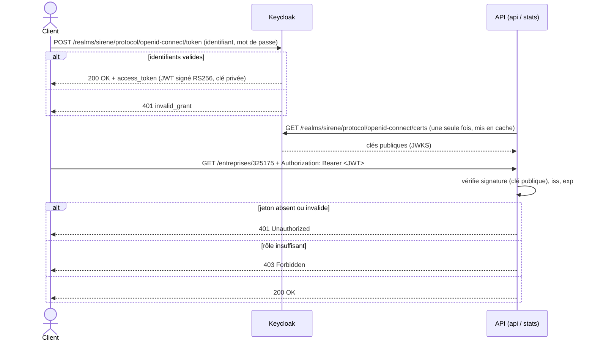
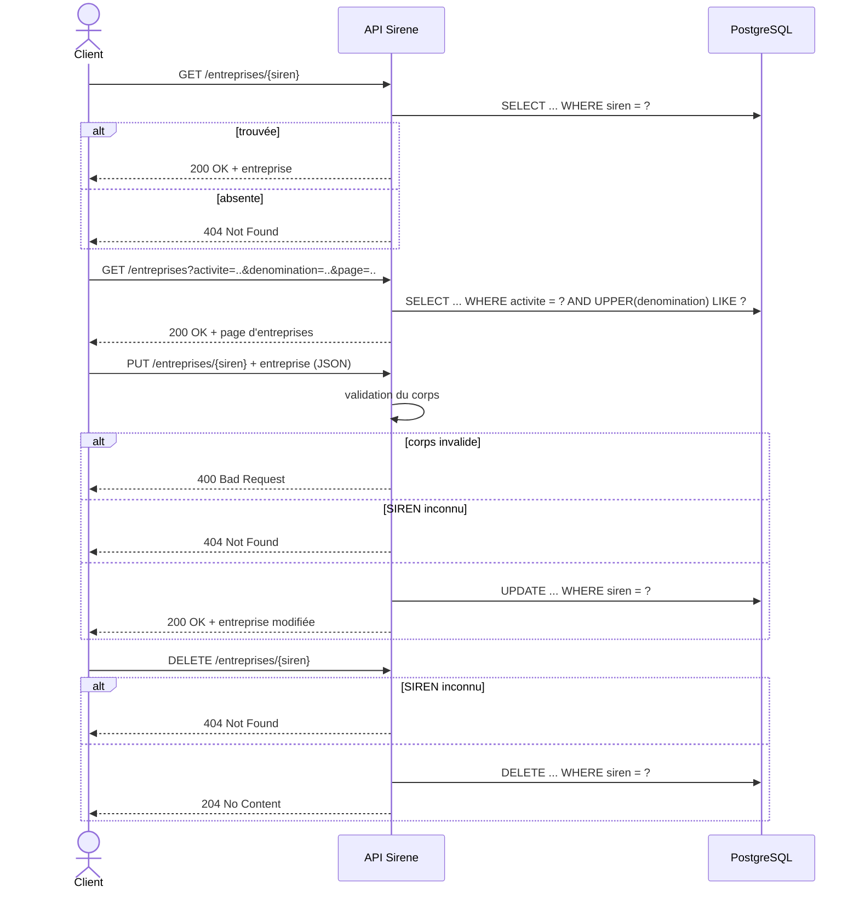

# API Sirene — alternative à l'API Société.com

API REST en **Java 21 / Spring Boot 3** qui sert les données de la
[base Sirene](https://www.data.gouv.fr/datasets/base-sirene-des-entreprises-et-de-leurs-etablissements-siren-siret)
(extrait de 100 000 unités légales), stockées dans **PostgreSQL**. L'accès est protégé par
**OAuth2** : les jetons JWT sont délivrés par **Keycloak** et signés en **RS256** (RSA, asymétrique).
Tout tourne dans Docker.

## Lancer l'application

Prérequis : Docker et Docker Compose.

```bash
docker compose up -d --build
```

Au premier démarrage, PostgreSQL importe `StockUniteLegale_100000_utf8.sql` (environ 30 s à 1 min)
et Keycloak crée le realm `sirene` à partir de `keycloak/realm-export.json`.
L'API ne démarre qu'une fois l'import terminé.

- API : http://localhost:8080/entreprises
- Swagger UI : http://localhost:8080/swagger-ui.html
- Spécification OpenAPI : http://localhost:8080/v3/api-docs
- Service de statistiques : http://localhost:8000/stats/activites
- Swagger du service de statistiques : http://localhost:8000/docs
- Keycloak (console d'administration, `admin` / `admin`) : http://localhost:8180

Arrêter : `docker compose down`. Pour réinitialiser les données : `docker compose down -v`.

## Sécurité : OAuth2 avec Keycloak

```
1. client ──(identifiant + mot de passe)──► Keycloak :8180
2. client ◄──── JWT signé (clé PRIVÉE RSA) ──── Keycloak
3. client ──(Authorization: Bearer <JWT>)──► api :8080 / stats :8000
4. api et stats vérifient la signature avec la clé PUBLIQUE de Keycloak → 200, 401 ou 403
```

- **Keycloak** est le serveur d'autorisation (SSO). Il signe les jetons avec sa clé privée RSA
  et publie sa clé publique sur `/realms/sirene/protocol/openid-connect/certs` (JWKS).
- **`api`** et **`stats`** sont des serveurs de ressources. Ils téléchargent la clé publique une fois,
  puis vérifient eux-mêmes chaque jeton : signature RS256, émetteur (`iss`) et expiration (`exp`).
  Ils ne rappellent pas Keycloak à chaque requête.
- Le realm, le client, les rôles et les utilisateurs sont importés automatiquement au démarrage :
  aucune configuration à faire à la main.

### Comptes de test (realm `sirene`)

| Utilisateur | Mot de passe | Rôles               | Droits                                                     |
|-------------|--------------|---------------------|------------------------------------------------------------|
| `lecteur`   | `lecteur`    | `lecteur`           | `GET /entreprises/**`, `GET /stats/**`                     |
| `admin`     | `admin`      | `lecteur`, `admin`  | tout, y compris `PUT` et `DELETE /entreprises/{siren}`     |

Client OAuth2 : `sirene-client` (client public). Durée de vie d'un jeton : 15 minutes.

### Obtenir un jeton

```bash
TOKEN=$(curl -s -X POST http://localhost:8180/realms/sirene/protocol/openid-connect/token \
  -d grant_type=password -d client_id=sirene-client \
  -d username=admin -d password=admin \
  | python3 -c 'import sys,json;print(json.load(sys.stdin)["access_token"])')

curl -H "Authorization: Bearer $TOKEN" http://localhost:8080/entreprises/325175
```

Dans Swagger (`/swagger-ui.html` ou `/docs`) : bouton **Authorize**, coller le jeton.

| Code    | Signification                                                                 |
|---------|-------------------------------------------------------------------------------|
| **401** | Pas de jeton, jeton expiré, signature invalide ou émetteur inattendu           |
| **403** | Jeton valide mais rôle insuffisant (ex. `DELETE` avec le compte `lecteur`)    |

La documentation (Swagger UI, OpenAPI) reste publique.

### Déploiement sur une autre machine (réseau St-Michel)

Le champ `iss` du jeton contient l'adresse publique de Keycloak, et les API vérifient qu'elle
correspond. Cette adresse vaut `http://localhost:8180` par défaut. Pour un accès depuis d'autres
machines, créer un fichier `.env` à côté de `docker-compose.yml` avec l'adresse IP du serveur :

```bash
echo "KC_HOSTNAME=http://<ip-du-serveur>:8180" > .env
docker compose up -d --build
```

Les autres machines demandent alors leurs jetons à `http://<ip-du-serveur>:8180/...`. Keycloak écrit
toujours `KC_HOSTNAME` dans `iss`, quelle que soit l'adresse utilisée pour le joindre.
Si `KC_HOSTNAME` change après un premier lancement, recréer Keycloak et les API :
`docker compose up -d --force-recreate keycloak api stats`.

Le TP fonctionne en HTTP (`start-dev`, `sslRequired: none`). En production, il faudrait servir
Keycloak et les API en HTTPS.

## Routes

Une seule ressource, `/entreprises`, identifiée par le **SIREN**.

| Méthode  | Route                    | Rôle                                                  | Rôle requis | Codes                   |
|----------|--------------------------|-------------------------------------------------------|-------------|-------------------------|
| `GET`    | `/entreprises/{siren}`   | Retrouver une entreprise par son identifiant          | `lecteur`   | 200, 401, 403, 404      |
| `GET`    | `/entreprises`           | Rechercher par code activité et/ou dénomination       | `lecteur`   | 200, 401, 403           |
| `PUT`    | `/entreprises/{siren}`   | Modifier une entreprise (nom, activité, correction…) | `admin`     | 200, 400, 401, 403, 404 |
| `DELETE` | `/entreprises/{siren}`   | Supprimer une entreprise (droit à l'oubli)            | `admin`     | 204, 401, 403, 404      |

Paramètres de recherche (`GET /entreprises`), tous optionnels et combinables :

- `activite` : code NAF exact, ex. `62.01Z`
- `denomination` : partie de la dénomination, insensible à la casse, ex. `boulang`
- `page`, `size`, `sort` : pagination (par défaut `page=0&size=20&sort=siren,asc`)

Les erreurs sont renvoyées au format `application/problem+json` (RFC 7807).

### Exemples

`$TOKEN` : voir [Obtenir un jeton](#obtenir-un-jeton) (compte `admin` pour `PUT` et `DELETE`).

```bash
AUTH="Authorization: Bearer $TOKEN"

curl -H "$AUTH" http://localhost:8080/entreprises/325175
curl -H "$AUTH" "http://localhost:8080/entreprises?activite=81.10Z&size=5"
curl -H "$AUTH" "http://localhost:8080/entreprises?denomination=boulangerie"

curl -X PUT http://localhost:8080/entreprises/325175 \
  -H "$AUTH" -H "Content-Type: application/json" \
  -d '{"dateCreation":"2000-09-26","prenom":"THIERRY","nom":"JANOYER","denomination":"NOUVEAU NOM",
       "activitePrincipale":"32.12Z","trancheEffectifs":"NN","etatAdministratif":"A"}'

curl -X DELETE -H "$AUTH" http://localhost:8080/entreprises/325175
```

### Représentation d'une entreprise

```json
{
  "siren": 325175,
  "dateCreation": "2000-09-26",
  "prenom": "THIERRY",
  "nom": "JANOYER",
  "denomination": null,
  "activitePrincipale": "32.12Z",
  "trancheEffectifs": "NN",
  "etatAdministratif": "A"
}
```

`siren` est en lecture seule : il est pris dans l'URL, jamais dans le corps.
`trancheEffectifs` et `etatAdministratif` (`A` = active, `C` = cessée) sont obligatoires.

## Service de statistiques (Python + Polars)

Un deuxième service (conteneur `stats`) lit **la même base PostgreSQL** et calcule des
statistiques sur les codes activité. La requête SQL est un simple `SELECT` des colonnes,
**sans `GROUP BY`** : tous les regroupements et comptages sont faits avec **Polars**.
Les modifications faites par l'API Java (`PUT`, `DELETE`) apparaissent donc tout de suite.

```
                       ┌──────────── clés publiques (JWKS) ────────────┐
                       │                                                ▼
           :8080 ──► api   (Java / Spring Boot) ──┐             keycloak :8180
                                                  ├──► db (PostgreSQL)  ▲
           :8000 ──► stats (Python / FastAPI / Polars) ──┘              │
                       └──────────── clés publiques (JWKS) ────────────┘
```

Toutes les routes `/stats` exigent un jeton avec le rôle `lecteur` ou `admin` (sinon 401 ou 403).

| Méthode | Route                       | Rôle                                                                 | Codes              |
|---------|-----------------------------|----------------------------------------------------------------------|--------------------|
| `GET`   | `/stats/activites?top=20`   | Nombre d'entreprises par code activité (actives, cessées, %)         | 200, 401, 403      |
| `GET`   | `/stats/activites/{code}`   | Détail d'un code : total, actives, cessées, tranches d'effectifs     | 200, 401, 403, 404 |
| `GET`   | `/stats/divisions?top=20`   | Regroupement par division NAF (2 premiers chiffres, ex. `62`)        | 200, 401, 403      |
| `GET`   | `/stats/creations`          | Nombre d'entreprises créées par année (dynamique des ouvertures)     | 200, 401, 403      |

```bash
curl -H "$AUTH" "http://localhost:8000/stats/activites?top=5"
curl -H "$AUTH" http://localhost:8000/stats/activites/10.71C
curl -H "$AUTH" "http://localhost:8000/stats/divisions?top=5"
curl -H "$AUTH" http://localhost:8000/stats/creations
```

Exemple de réponse de `/stats/activites/10.71C` :

```json
{
  "activite": "10.71C",
  "nombre": 22,
  "actives": 13,
  "cessees": 9,
  "tranchesEffectifs": [{"tranche": "NN", "nombre": 19}, {"tranche": "3", "nombre": 2}, {"tranche": "11", "nombre": 1}]
}
```

**Codes communes :** le jeu de données fourni (unités légales) ne contient pas de colonne
commune ; elle se trouve dans le fichier des *établissements* Sirene. Cette option n'est
donc pas réalisable avec ces données.

## Diagrammes de séquence

### Authentification OAuth2



### Routes de l'API



## Structure

```
src/main/java/fr/saintmichel/sirene/
├── SireneApplication.java      # point d'entrée
├── Entreprise.java             # entité JPA (table "mytable" du jeu de données)
├── EntrepriseRepository.java   # accès aux données (requêtes générées par Spring)
├── EntrepriseController.java   # les 4 routes REST
├── SecurityConfig.java         # OAuth2 : vérification des JWT et règles d'accès par rôle
└── OpenApiConfig.java          # bouton "Authorize" dans Swagger UI

stats/
├── main.py                     # service de statistiques (FastAPI + Polars)
├── auth.py                     # vérification des JWT Keycloak (PyJWT)
├── requirements.txt            # dépendances Python
└── Dockerfile

keycloak/
└── realm-export.json           # realm "sirene" importé au démarrage (client, rôles, utilisateurs)
```
