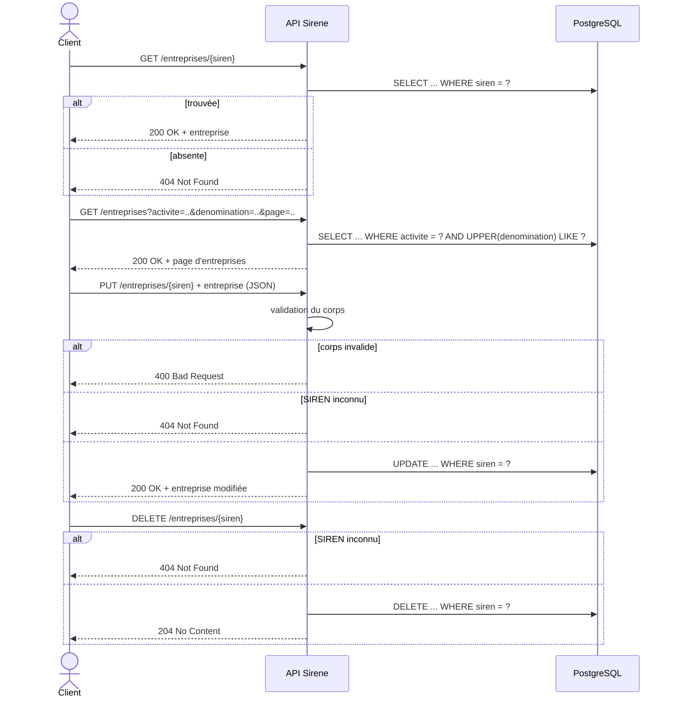

# API Sirene — alternative à l'API Société.com

API REST en **Java 21 / Spring Boot 3** qui sert les données de la
[base Sirene](https://www.data.gouv.fr/datasets/base-sirene-des-entreprises-et-de-leurs-etablissements-siren-siret)
(extrait de 100 000 unités légales), stockées dans **PostgreSQL**. Tout tourne dans Docker.

## Lancer l'application

Prérequis : Docker et Docker Compose.

```bash
docker compose up -d --build
```

Au premier démarrage, PostgreSQL importe `StockUniteLegale_100000_utf8.sql` (environ 30 s à 1 min).
L'API ne démarre qu'une fois l'import terminé.

- API : http://localhost:8080/entreprises
- Swagger UI : http://localhost:8080/swagger-ui.html
- Spécification OpenAPI : http://localhost:8080/v3/api-docs
- Service de statistiques : http://localhost:8000/stats/activites
- Swagger du service de statistiques : http://localhost:8000/docs

Arrêter : `docker compose down`. Pour réinitialiser les données : `docker compose down -v`.

## Routes

Une seule ressource, `/entreprises`, identifiée par le **SIREN**.

| Méthode  | Route                    | Rôle                                                  | Codes         |
|----------|--------------------------|-------------------------------------------------------|---------------|
| `GET`    | `/entreprises/{siren}`   | Retrouver une entreprise par son identifiant          | 200, 404      |
| `GET`    | `/entreprises`           | Rechercher par code activité et/ou dénomination       | 200           |
| `PUT`    | `/entreprises/{siren}`   | Modifier une entreprise (nom, activité, correction…) | 200, 400, 404 |
| `DELETE` | `/entreprises/{siren}`   | Supprimer une entreprise (droit à l'oubli)            | 204, 404      |

Paramètres de recherche (`GET /entreprises`), tous optionnels et combinables :

- `activite` : code NAF exact, ex. `62.01Z`
- `denomination` : partie de la dénomination, insensible à la casse, ex. `boulang`
- `page`, `size`, `sort` : pagination (par défaut `page=0&size=20&sort=siren,asc`)

Les erreurs sont renvoyées au format `application/problem+json` (RFC 7807).

### Exemples

```bash
curl http://localhost:8080/entreprises/325175
curl "http://localhost:8080/entreprises?activite=81.10Z&size=5"
curl "http://localhost:8080/entreprises?denomination=boulangerie"

curl -X PUT http://localhost:8080/entreprises/325175 \
  -H "Content-Type: application/json" \
  -d '{"dateCreation":"2000-09-26","prenom":"THIERRY","nom":"JANOYER","denomination":"NOUVEAU NOM",
       "activitePrincipale":"32.12Z","trancheEffectifs":"NN","etatAdministratif":"A"}'

curl -X DELETE http://localhost:8080/entreprises/325175
```

### Représentation d'une entreprise

```json
{
  "siren": 325175,
  "dateCreation": "2000-09-26",
  "prenom": "THIERRY",
  "nom": "JANOYER",
  "denomination": null,
  "activitePrincipale": "32.12Z",
  "trancheEffectifs": "NN",
  "etatAdministratif": "A"
}
```

`siren` est en lecture seule : il est pris dans l'URL, jamais dans le corps.
`trancheEffectifs` et `etatAdministratif` (`A` = active, `C` = cessée) sont obligatoires.

## Service de statistiques (Python + Polars)

Un deuxième service (conteneur `stats`) lit **la même base PostgreSQL** et calcule des
statistiques sur les codes activité. La requête SQL est un simple `SELECT` des colonnes,
**sans `GROUP BY`** : tous les regroupements et comptages sont faits avec **Polars**.
Les modifications faites par l'API Java (`PUT`, `DELETE`) apparaissent donc tout de suite.

```
           :8080 ──► api   (Java / Spring Boot) ──┐
                                                  ├──► db (PostgreSQL)
           :8000 ──► stats (Python / FastAPI / Polars) ──┘
```

| Méthode | Route                       | Rôle                                                                 | Codes    |
|---------|-----------------------------|----------------------------------------------------------------------|----------|
| `GET`   | `/stats/activites?top=20`   | Nombre d'entreprises par code activité (actives, cessées, %)         | 200      |
| `GET`   | `/stats/activites/{code}`   | Détail d'un code : total, actives, cessées, tranches d'effectifs     | 200, 404 |
| `GET`   | `/stats/divisions?top=20`   | Regroupement par division NAF (2 premiers chiffres, ex. `62`)        | 200      |
| `GET`   | `/stats/creations`          | Nombre d'entreprises créées par année (dynamique des ouvertures)     | 200      |

```bash
curl "http://localhost:8000/stats/activites?top=5"
curl http://localhost:8000/stats/activites/10.71C
curl "http://localhost:8000/stats/divisions?top=5"
curl http://localhost:8000/stats/creations
```

Exemple de réponse de `/stats/activites/10.71C` :

```json
{
  "activite": "10.71C",
  "nombre": 22,
  "actives": 13,
  "cessees": 9,
  "tranchesEffectifs": [{"tranche": "NN", "nombre": 19}, {"tranche": "3", "nombre": 2}, {"tranche": "11", "nombre": 1}]
}
```

**Codes communes :** le jeu de données fourni (unités légales) ne contient pas de colonne
commune ; elle se trouve dans le fichier des *établissements* Sirene. Cette option n'est
donc pas réalisable avec ces données.

## Diagramme de séquence



## Structure

```
src/main/java/fr/saintmichel/sirene/
├── SireneApplication.java      # point d'entrée
├── Entreprise.java             # entité JPA (table "mytable" du jeu de données)
├── EntrepriseRepository.java   # accès aux données (requêtes générées par Spring)
└── EntrepriseController.java   # les 4 routes REST

stats/
├── main.py                     # service de statistiques (FastAPI + Polars)
├── requirements.txt            # dépendances Python
└── Dockerfile
```
